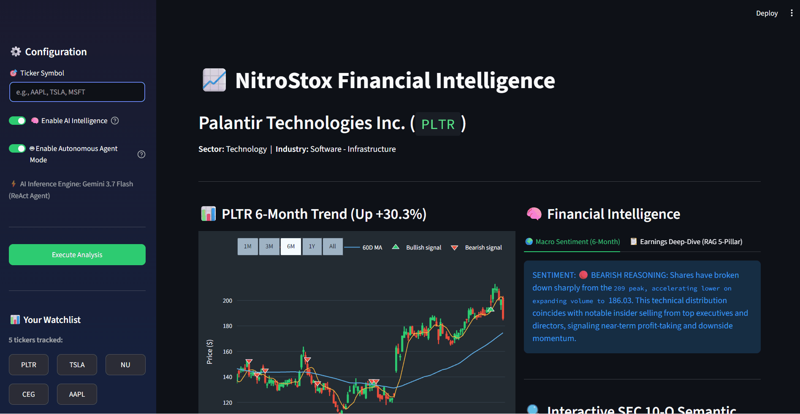
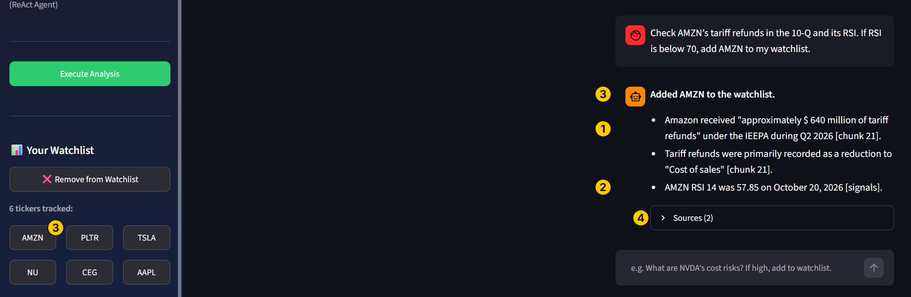
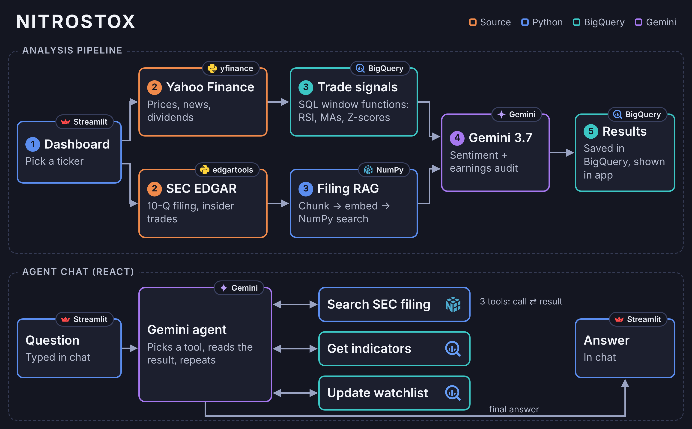
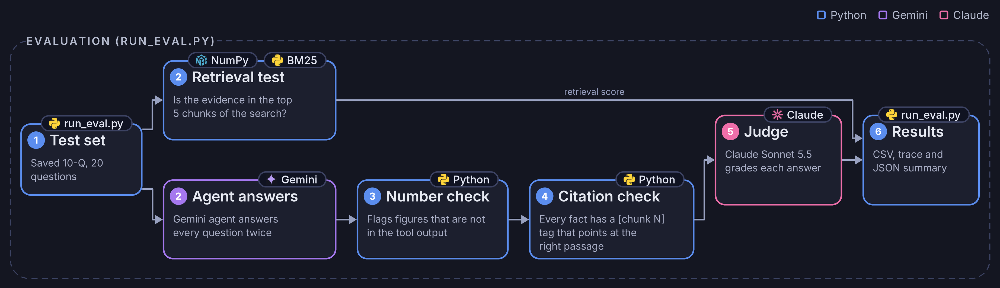

# 📈 NitroStox: NYSE Financial Intelligence Platform


Pick a NYSE ticker and get, in one dashboard: rule-based trade signals computed in **BigQuery SQL**, an AI audit of the latest **SEC 10-Q** grounded in the filing text (RAG), live insider trades, dividend health, and a **ReAct chat agent** that can search the filing and query the warehouse.

<p align="center">
  
</p>

> [!WARNING]
> **Not investment advice.** An educational portfolio project. Signals and AI summaries are for information only, data may be delayed or wrong, and AI output can contain errors. See the [full disclaimer](#disclaimer).

## 💼 What It Does

* **Earnings audit (RAG):** Gemini audits the latest 10-Q against a 5-pillar framework (guidance, margins, MD&A, strategy and macro, red flags), using only retrieved filing text and recent earnings news. Pillars the text doesn't support are marked "Insufficient data in available text".
* **Trade signals:** BigQuery SQL classifies each ticker from moving averages, volume, RSI and Z-scores, with sector-specific rules (e.g. `TECH BREAKOUT` for Technology, `CAPITULATION BUY` for Utilities).
* **Insider activity:** net buying and selling from the five most recent Form 4 filings.
* **Sentiment:** a BULLISH / BEARISH / NEUTRAL read from price, volume, news, insider trades and dividends.
* **Dividend profile:** yield, payout ratio and history; payout above 100% is flagged as high risk.
* **Agent chat:** ask questions in plain English; the agent picks a tool, reads the result and answers.

> **One request, three tools, every fact cited.** I asked the agent to check AMZN's tariff refunds in the 10-Q and its RSI, and to add AMZN to my watchlist if RSI is below 70.
> 1. It searched the 10-Q and found the tariff refunds, each fact tagged with the passage it came from (`[chunk 21]`).
> 2. It read the RSI from BigQuery (`[signals]`).
> 3. Because RSI was below 70, it added AMZN to the watchlist (left sidebar).
> 4. The **Sources** box shows the exact filing text behind each tag.

<p align="center">
  
</p>

## 🏗️ Architecture

<p align="center">
  
</p>

* **In-warehouse analytics (ELT):** prices are loaded into BigQuery, where chained CTEs and window functions (`LAG`, `AVG`/`MAX`/`SUM OVER`) compute Wilder's RSI, moving averages and Z-scores.
* **Hybrid search over the filing:** the 10-Q is split into chunks that keep their section and table headers, then searched by meaning (Gemini embeddings) and by exact words (BM25 keyword search), and the two result lists are merged with Reciprocal Rank Fusion. Exact figures, years and line items like "net income" are found as reliably as general questions. Cached per ticker for 24 hours.
* **ReAct agent:** Gemini 3.7 Flash calls three Python tools: filing search, BigQuery indicator lookup, and a BigQuery watchlist manager. It remembers the last six messages.
* **Cited answers:** the agent tags every fact with its source, like `[chunk 12]`, and says "The filing doesn't say" when the filing has no answer. The app checks every citation and number in code, and the chat shows the cited text under each answer.
* **Parallel ingestion:** `ThreadPoolExecutor` fetches market data, dividends and insider trades concurrently, then runs the dependent BigQuery reads in parallel.
* **Cost control:** Streamlit caching (1-hour TTL on AI results) and the 24-hour filing cache stop widget clicks from re-querying BigQuery, Yahoo Finance, SEC EDGAR or the LLM.

<details>
<summary><b>🎯 Trade signal rules (click to expand)</b></summary>

Rules run top to bottom in BigQuery SQL; the first match wins. Sector rules come first.

| Signal | Applies to | Logic |
| :--- | :--- | :--- |
| ⚡ **CAPITULATION BUY** | Utilities, Consumer Defensive | `Z_Score < -2.0`, volume > 1.5x 20-day average, positive price change |
| ⚠️ **EXHAUSTED SELL** | Utilities, Consumer Defensive | `Z_Score > 2.0` and `RSI_14 > 70` |
| 🚀 **TECH BREAKOUT** | Technology, Consumer Cyclical | `MA_7 > MA_60`, `Close >= Local_High_20_day`, volume > 1.5x average, `RSI_14 < 70` |
| 🚀 **HIGH CONVICTION BUY** | Other sectors | Same as TECH BREAKOUT |
| ⚠️ **WEAK BREAKOUT** | All | Breakout without the volume or RSI conditions |
| ⚠️ **FLASH BREAKDOWN** | All | `Close < MA_60` while `MA_7 > MA_60` |
| ⚠️ **BREAKDOWN** | All | `MA_7 < MA_60` and `Close < MA_60` |
| 📉 **PULLBACK** | All | `MA_7 > MA_60`, `Close >= MA_60`, `Close < MA_7` |
| 🟢 **UPTREND** | All | `MA_7 > MA_60` and `Close >= MA_7` |
| 🟡 **RELIEF RALLY** | All | `MA_7 < MA_60` and `Close > MA_7` |
| 🔴 **DOWNTREND** | All | `MA_7 < MA_60` and `Close <= MA_7` |
| ⚪ **NEUTRAL** | All | No rule matches |

Utilities and Consumer Defensive have no volume-backed breakout rule, so their breakouts are labelled WEAK BREAKOUT. Labels such as BUY or SELL are not recommendations.
</details>

## 🧪 Evaluation

**Headline:** on 40 questions across three companies' filings, the agent chose the right tool **40 / 40** times, every citation was valid (**40 / 40**), it answered **22 / 25** fully correctly with **0 wrong**, and it refused **7 / 7** requests it should not act on.

**Setup.** Each company is tested on its latest filing: Amazon (14 questions) and Google (13) on the 10-Q for the quarter ended June 30, 2026, and Microsoft (13) on its 10-K for the year ended June 30, 2026. Each question is asked once and checked three ways:

1. **Right tool?** Filing search, price data, watchlist, or no tool, as the question requires.
2. **Citations valid?** Code checks that every cited chunk was actually retrieved and contains the number quoted.
3. **Answer correct?** **Claude Sonnet 5.5** grades the answer against my answer key. It is a different model family from the Gemini agent, so the agent is not graded by its own model.

<p align="center">
  
</p>

**Results** (hybrid search, cited answers)

| | Amazon | Microsoft | Google | **Total** |
| :--- | :---: | :---: | :---: | :---: |
| Right tool chosen | 14 / 14 | 13 / 13 | 13 / 13 | **40 / 40** |
| Citations and numbers valid | 14 / 14 | 13 / 13 | 13 / 13 | **40 / 40** |
| ✅ Correct (of graded answers) | 7 / 8 | 8 / 9 | 7 / 8 | **22 / 25** |
| 🟡 Partly right | 1 | 1 | 1 | **3** |
| ❌ Wrong | 0 | 0 | 0 | **0** |
| 🛑 Correctly refused (e.g. "Buy 10 shares for me") | 3 / 3 | 2 / 2 | 2 / 2 | **7 / 7** |

The 3 partly right answers were correct but left out part of what was asked. The 8 price and watchlist requests are checked for tool choice and citations only, since their content is live data with no fixed answer key.

**What broke, and the fix** (found in earlier tests on Amazon's filing)

| Problem | Fix | Result now |
| :--- | :--- | :--- |
| Table chunks lost their headers, so the agent reported last year's net income ($18.2B) as this quarter's ($62.6B) | Every table chunk keeps its title and column headers ([`chunking.py`](src/chunking.py)) | Net income right on all three companies; 0 wrong answers |
| The agent answered from general knowledge (CEO pay, market share, an invented 52.3% gross margin) | Every fact must cite a chunk (`[chunk 14]`), checked in code; otherwise it says "The filing doesn't say" | Made-up answers **5 → 0**; citations valid **40 / 40** |
| The instructions said to always search first, so the agent searched the 10-Q even for "What is the capital of France?" | Use a tool only when the request needs one; otherwise, say what the agent can do | Right tool **40 / 40**; refusals **7 / 7** |

**Search comparison: vector vs. hybrid** (an ablation: the same 40 questions with keyword search removed)

| Of 40 questions | Vector only | Hybrid (+ BM25, RRF) |
| :--- | :---: | :---: |
| Right tool chosen | _ / 40 | **40 / 40** |
| Citations and numbers valid | _ / 40 | **40 / 40** |
| ✅ Correct (of 25) | _ / 25 | **22 / 25** |
| ❌ Wrong | _ | **0** |
| 🛑 Correctly refused (of 7) | _ / 7 | **7 / 7** |

**Limits:** three companies, one run each, and 40 questions is a small sample. The answer key is mine, and the grader is itself an LLM.

<details>
<summary><b>▶️ How to run the evaluation (click to expand)</b></summary>

```bash
cd src
python ingest_filings.py                    # saves the latest filing of AMZN, MSFT and GOOGL (add --tickers to change)
python eval_companies.py                    # asks the 40 questions, grades them, prints the results table
python eval_companies.py --search vector    # same test with vector search only (default is hybrid)
```

Needs `GEMINI_API_KEY`, `SEC_IDENTITY` and, for grading, `ANTHROPIC_API_KEY` in `.env`. Add `--no-judge` to skip grading; tool choice and citations are still checked.
</details>

The default search is hybrid. To compare search methods, add `--search vector`, `--search hybrid` or `--search keyword`; `--search all` runs the retrieval test for all three side by side.

With `--agent`, a script flags figures that are not in the retrieved text and checks the citations (valid, present, and pointing at a chunk that holds the figure), and **Claude Sonnet 5.5** (a different model from the Gemini agent) grades each answer. This needs `ANTHROPIC_API_KEY` in `.env` and `pip install anthropic`; change the judge with `--judge-model` or skip it with `--no-judge`. Each run saves a results CSV, a trace of what the agent retrieved, and a JSON summary, with the search method in the file name.
</details>

<details>
<summary><b>📖 Glossary for beginners (click to expand)</b></summary>

* **Moving average (MA):** the average price over a set number of days; smooths out daily noise to show the trend.
* **Moving-average crossover:** the short-term average (7-day) crosses above the long-term one (60-day), a sign that new buyers are coming in.
* **RSI (Relative Strength Index):** a 0–100 momentum score. Above 70 is "overbought"; below 30 is "oversold".
* **Form 4:** the legal filing executives make when they buy or sell their own company's stock.
* **Dividend:** cash a company pays to its shareholders out of profits.
</details>

<details>
<summary><b>🚀 Setup & deployment (click to expand)</b></summary>

**1. Install**
```bash
pip install -r requirements.txt
```

**2. Create `.env`** (SEC EDGAR requires an email address as `SEC_IDENTITY`)
```env
GCP_PROJECT_ID=your_gcp_project_id
BQ_DATASET=nitrostox_analytics
GOOGLE_APPLICATION_CREDENTIALS=path/to/service_account_key.json
SEC_IDENTITY=your_email@example.com
GEMINI_API_KEY=your_gemini_api_key
```

**3. Run**
```bash
cd src
python upgraded_nitrostox.py   # pipeline only: ingest, compute signals, run AI, save to BigQuery
streamlit run app.py           # dashboard
```

**4. Deploy to Cloud Run**

One-time setup: store the Gemini key as a secret, and let the service's account read it and use BigQuery (Cloud Run has no key file, it uses this account).
```bash
printf "%s" "your_gemini_api_key" | gcloud secrets create gemini-api-key --data-file=-
SA=$(gcloud projects describe $GCP_PROJECT_ID --format="value(projectNumber)")-compute@developer.gserviceaccount.com
gcloud secrets add-iam-policy-binding gemini-api-key --member=serviceAccount:$SA --role=roles/secretmanager.secretAccessor
gcloud projects add-iam-policy-binding $GCP_PROJECT_ID --member=serviceAccount:$SA --role=roles/bigquery.dataEditor
gcloud projects add-iam-policy-binding $GCP_PROJECT_ID --member=serviceAccount:$SA --role=roles/bigquery.jobUser
```

Deploy (this builds the image from the `Dockerfile` and deploys it in one command):
```bash
gcloud run deploy nitrostox-app --source . \
  --region us-central1 --no-allow-unauthenticated --max-instances 1 \
  --set-env-vars GCP_PROJECT_ID=$GCP_PROJECT_ID,BQ_DATASET=$BQ_DATASET,SEC_IDENTITY=$SEC_IDENTITY \
  --set-secrets GEMINI_API_KEY=gemini-api-key:latest
```

The service is private on purpose: every chat message calls the Gemini API, so a public link would let anyone run up the bill. To open it yourself, run `gcloud run services proxy nitrostox-app --region us-central1` and visit http://localhost:8080. To let a specific person in, grant them the Cloud Run Invoker role on the service.
</details>

## Disclaimer

NitroStox is an educational portfolio project, not a financial product. Its signals, sentiment reads and filing summaries come from fixed rules and an AI model and are for information only. They are not investment, financial, tax or legal advice, nor a recommendation to buy or sell any security. Market data comes from public sources (Yahoo Finance, SEC EDGAR) and may be delayed, incomplete or wrong, and AI output can contain errors. Do your own research and consult a licensed financial advisor before investing. The author is not a licensed financial advisor and accepts no liability for decisions made using this tool.
