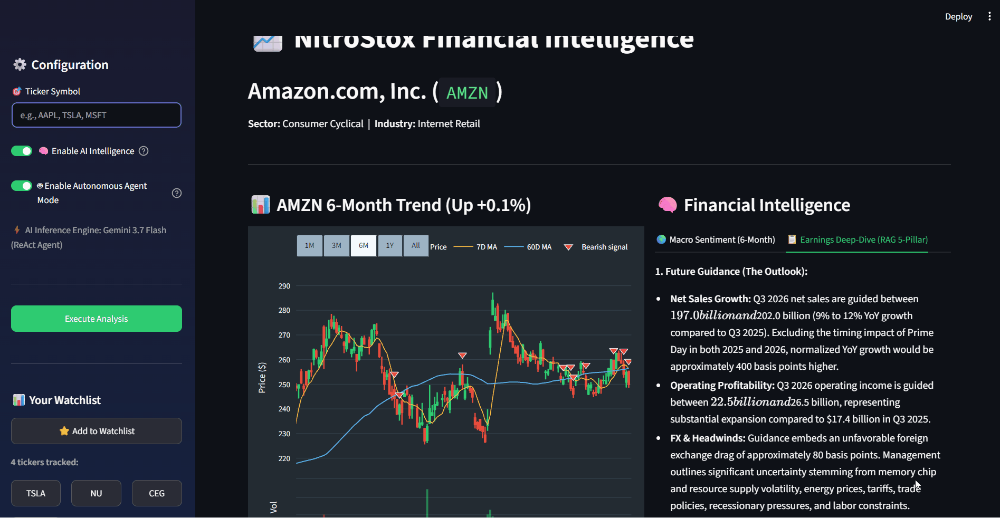

# 📈 NitroStox: NYSE Financial Intelligence Platform


Pick a NYSE ticker and get, in one dashboard: rule-based trade signals computed in **BigQuery SQL**, an AI audit of the latest **SEC 10-Q** grounded in the filing text (RAG), live insider trades, dividend health, and a **ReAct chat agent** that can search the filing and query the warehouse.



> [!WARNING]
> **Not investment advice.** An educational portfolio project. Signals and AI summaries are for information only, data may be delayed or wrong, and AI output can contain errors. See the [full disclaimer](#disclaimer).

## 💼 What It Does

* **Earnings audit (RAG):** Gemini audits the latest 10-Q against a 5-pillar framework (guidance, margins, MD&A, strategy and macro, red flags), using only retrieved filing text and recent earnings news. Pillars the text doesn't support are marked "Insufficient data in available text".
* **Trade signals:** BigQuery SQL classifies each ticker from moving averages, volume, RSI and Z-scores, with sector-specific rules (e.g. `TECH BREAKOUT` for Technology, `CAPITULATION BUY` for Utilities).
* **Insider activity:** net buying and selling from the five most recent Form 4 filings.
* **Sentiment:** a BULLISH / BEARISH / NEUTRAL read from price, volume, news, insider trades and dividends.
* **Dividend profile:** yield, payout ratio and history; payout above 100% is flagged as high risk.
* **Agent chat:** ask questions in plain English; the agent picks a tool, reads the result and answers.

## 🏗️ Architecture

<p align="center">
  
</p>

* **In-warehouse analytics (ELT):** prices are loaded into BigQuery, where chained CTEs and window functions (`LAG`, `AVG`/`MAX`/`SUM OVER`) compute Wilder's RSI, moving averages and Z-scores.
* **In-memory vector RAG:** the filing is split into 2,000-character chunks (300 overlap), embedded with `gemini-embedding-001`, and ranked by NumPy cosine similarity. The index is cached per ticker for 24 hours, not stored in BigQuery.
* **ReAct agent:** Gemini 3.7 Flash calls three Python tools: filing search, BigQuery indicator lookup, and a BigQuery watchlist manager. It remembers the last six messages.
* **Parallel ingestion:** `ThreadPoolExecutor` fetches market data, dividends and insider trades concurrently, then runs the dependent BigQuery reads in parallel.
* **Cost control:** Streamlit caching (1-hour TTL on AI results) and the 24-hour filing cache stop widget clicks from re-querying BigQuery, Yahoo Finance, SEC EDGAR or the LLM.

<details>
<summary><b>🎯 Trade signal rules (click to expand)</b></summary>

Rules run top to bottom in BigQuery SQL; the first match wins. Sector rules come first.

| Signal | Applies to | Logic |
| :--- | :--- | :--- |
| ⚡ **CAPITULATION BUY** | Utilities, Consumer Defensive | `Z_Score < -2.0`, volume > 1.5x 20-day average, positive price change |
| ⚠️ **EXHAUSTED SELL** | Utilities, Consumer Defensive | `Z_Score > 2.0` and `RSI_14 > 70` |
| 🚀 **TECH BREAKOUT** | Technology, Consumer Cyclical | `MA_7 > MA_60`, `Close >= Local_High_20_day`, volume > 1.5x average, `RSI_14 < 70` |
| 🚀 **HIGH CONVICTION BUY** | Other sectors | Same as TECH BREAKOUT |
| ⚠️ **WEAK BREAKOUT** | All | Breakout without the volume or RSI conditions |
| ⚠️ **FLASH BREAKDOWN** | All | `Close < MA_60` while `MA_7 > MA_60` |
| ⚠️ **BREAKDOWN** | All | `MA_7 < MA_60` and `Close < MA_60` |
| 📉 **PULLBACK** | All | `MA_7 > MA_60`, `Close >= MA_60`, `Close < MA_7` |
| 🟢 **UPTREND** | All | `MA_7 > MA_60` and `Close >= MA_7` |
| 🟡 **RELIEF RALLY** | All | `MA_7 < MA_60` and `Close > MA_7` |
| 🔴 **DOWNTREND** | All | `MA_7 < MA_60` and `Close <= MA_7` |
| ⚪ **NEUTRAL** | All | No rule matches |

Utilities and Consumer Defensive have no volume-backed breakout rule, so their breakouts are labelled WEAK BREAKOUT. Labels such as BUY or SELL are not recommendations.
</details>

## 🧪 Evaluation

I tested the filing Q&A agent on **Amazon's latest 10-Q**: 20 questions, each asked twice, so **40 answers**. 14 questions are answered in the filing; 6 are not, to see if the agent admits it doesn't know. I graded every answer by hand.

<p align="center">
  
</p>

| Of 40 answers | Count | Example |
| :--- | :---: | :--- |
| ✅ Correct | **24** | Revenue $200.6B, up 20% |
| 🟡 Partly right | **6** | Named only 1 of 3 legal cases |
| ❌ Wrong | **2** | Quoted last year's net income ($18.2B) as this quarter's ($62.6B) |
| 🚫 Made up or from outside knowledge | **8** | Gross margin isn't in the filing, and the agent made up 52.3% |

The search step found the right passage for **12 of 14** answerable questions.

**What it found**
1. **Tables lose their headers when chunked.** The agent reported $18.2B (last year's net income) instead of $62.6B (this quarter's).
2. **The chat agent isn't told to stick to the filing,** so it answers from general knowledge (CEO pay, market share).

**Next:** keep table headers in each chunk, add a filing-only rule to the agent, re-run.

**How to run**

```bash
cd src
python save_filing.py                  # saves the filing as filing_<TICKER>.txt
python run_eval.py                     # retrieval test only
python run_eval.py --agent --runs 2    # also asks the agent every question and grades the answers
```

With `--agent`, a script flags figures that are not in the retrieved text, and **Claude Sonnet 5.5** (a different model from the Gemini agent) grades each answer. This needs `ANTHROPIC_API_KEY` in `.env` and `pip install anthropic`; change the judge with `--judge-model` or skip it with `--no-judge`. Judge results are not published yet; the table above is hand-graded. Each run saves a results CSV, a trace of what the agent retrieved, and a JSON summary.

## ⚠️ Limitations & Next Steps

| Limitation | Next step |
| :--- | :--- |
| Chat agent can answer from outside knowledge | Restrict filing questions to retrieved text |
| Fixed-size chunks cut tables and sections | Keep column headers with table chunks; chunk by section |
| Refusals are prompt-enforced; search has no similarity cutoff | Add a code-level relevance threshold |
| Only the latest filing, in memory, one ticker at a time | Persist vectors if the corpus grows |
| AI errors are cached for an hour; saved results aren't de-duplicated | Skip caching errors; upsert results per ticker |
| Evaluation covers one company | Rerun against this baseline and add a second company |

<details>
<summary><b>📖 Glossary for beginners (click to expand)</b></summary>

* **Moving average (MA):** the average price over a set number of days; smooths out daily noise to show the trend.
* **Moving-average crossover:** the short-term average (7-day) crosses above the long-term one (60-day), a sign that new buyers are coming in.
* **RSI (Relative Strength Index):** a 0–100 momentum score. Above 70 is "overbought"; below 30 is "oversold".
* **Form 4:** the legal filing executives make when they buy or sell their own company's stock.
* **Dividend:** cash a company pays to its shareholders out of profits.
</details>

<details>
<summary><b>🚀 Setup & deployment (click to expand)</b></summary>

**1. Install**
```bash
pip install -r requirements.txt
```

**2. Create `.env`** (SEC EDGAR requires an email address as `SEC_IDENTITY`)
```env
GCP_PROJECT_ID=your_gcp_project_id
BQ_DATASET=nitrostox_analytics
GOOGLE_APPLICATION_CREDENTIALS=path/to/service_account_key.json
SEC_IDENTITY=your_email@example.com
GEMINI_API_KEY=your_gemini_api_key
```

**3. Run**
```bash
cd src
python upgraded_nitrostox.py   # pipeline only: ingest, compute signals, run AI, save to BigQuery
streamlit run app.py           # dashboard
```

**4. Deploy to Cloud Run**
```bash
gcloud builds submit --tag gcr.io/$GCP_PROJECT_ID/nitrostox-app
gcloud run deploy nitrostox-app \
  --image gcr.io/$GCP_PROJECT_ID/nitrostox-app \
  --platform managed --region us-central1 --allow-unauthenticated \
  --set-env-vars GCP_PROJECT_ID=$GCP_PROJECT_ID,BQ_DATASET=$BQ_DATASET,SEC_IDENTITY=$SEC_IDENTITY \
  --set-secrets GEMINI_API_KEY=gemini-api-key:latest
```
</details>

## Disclaimer

NitroStox is an educational portfolio project, not a financial product. Its signals, sentiment reads and filing summaries come from fixed rules and an AI model and are for information only. They are not investment, financial, tax or legal advice, nor a recommendation to buy or sell any security. Market data comes from public sources (Yahoo Finance, SEC EDGAR) and may be delayed, incomplete or wrong, and AI output can contain errors. Do your own research and consult a licensed financial advisor before investing. The author is not a licensed financial advisor and accepts no liability for decisions made using this tool.
